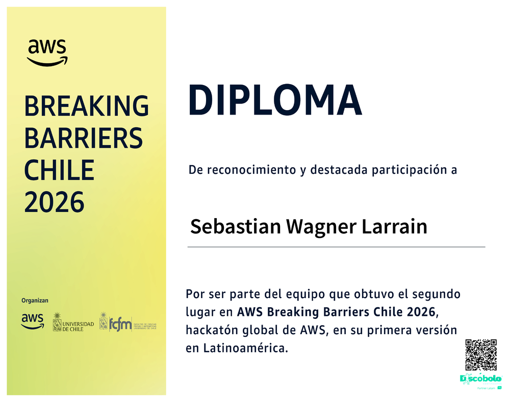

<div align="center">

# Sebastián Wagner

**I write the code that makes frontier AI run on hardware people already own.**

[](https://wagnersolutionsai.com/)
[](https://www.linkedin.com/in/sebasti%C3%A1n-wagner/)
[](https://github.com/SebaWag?tab=pull-requests)


</div>

---

Chilean engineer. I work on the layer most people skip: **the engine, not the model**.

Frontier AI is not limited by intelligence anymore — it is limited by **who controls the infrastructure to run it**. So I contribute to the projects that shrink that gap: inference engines that fit a dense trunk into consumer RAM, terminal tools that survive real workloads, graph databases that make knowledge queryable without a cloud bill.

I don't open PRs to test the water. **90% of the PRs I open get merged.** Every claim below is a commit someone else reviewed and accepted.

---

## 🏆 Second place — BreakingBarriers CL Hackathon (AWS)

[](https://github.com/mauriciovalenzuela742/IntegrAI)

**IntegrAI** — an early-childhood assessment system built in 48 hours, awarded **2nd place** at the **BreakingBarriers CL** hackathon sponsored by **AWS**.

<!-- TODO: subir el badge oficial a assets/ y descomentar:
<p align="center">
  
</p>
-->

It wasn't a prototype that died with the demo. It went to production:

- **31 pull requests merged** — the most of any project I've touched
- A deterministic + ML **decision engine** with a margin-based gate and a human-in-the-loop verification queue
- **Real-time dashboard** (SSE) so teachers see each case as it arrives
- WhatsApp ingestion, multi-child message routing, and a held-out evaluation improved from **11.9% → 96.3%**

> A system that decides something about a child's development must be auditable, not confident. That principle shaped the architecture.

---

## 🔧 Merged in other people's code

| Project | What it is | Stars | Merged | What I shipped |
|---|---|--:|--:|---|
| [**Colibri**](https://github.com/JustVugg/colibri) | Frontier MoE inference in pure C, zero dependencies | **48.3k** | **3 / 3** | [`TRUNK_RESIDENT_LAYERS=N`](https://github.com/JustVugg/colibri/pull/1399) — dense trunk from **1,128 MB → 64 MB (−94%)**, byte-identical output. Shipped in the official release. |
| [**TUIOS**](https://github.com/Gaurav-Gosain/tuios) | Terminal UI OS / multiplexer in Go | **6.4k** | **12 / 15** | Data-race fix that crashed the daemon ([#184](https://github.com/Gaurav-Gosain/tuios/pull/184)), clipboard fallback for SSH/VTE, percent-based pane resize, zen mode, regression tests. |
| [**MillenniumDB**](https://github.com/MillenniumDB/MillenniumDB) | Property-graph + RDF engine in C++ | 267 | **2 / 5** | One-shot installer and server bootstrap scripts ([#111](https://github.com/MillenniumDB/MillenniumDB/pull/111), [#112](https://github.com/MillenniumDB/MillenniumDB/pull/112)). |
| [**hermes-agent**](https://github.com/NousResearch/hermes-agent) | Agent framework by Nous Research | **261k** | *in review* | [`samskara`](https://github.com/NousResearch/hermes-agent/pull/149823) — a relational memory provider plugin with weight and doubt. |

**66 merged · 48 in repositories I don't own · 73 opened · 90% merge rate.**

*Measured directly against the GitHub API (Nov 2026). GitHub's Pull Shark tiers lag by months — they count what was merged a while ago, not what shipped last week.*

---

## 🛠️ Projects I own

**[expediente](https://github.com/SebaWag/expediente)** · `Python` · *verifiable evidence engine for public procurement*
Every claim is footnoted to a source document. **264 tests**, real CI against a **MillenniumDB** instance, **64.8M triples** loaded, 12 topics, MIT. Anti-corruption infrastructure for Chile — built so a journalist can check it, not trust it.

**[onboarding-hub](https://github.com/SebaWag/onboarding-hub)** · `TypeScript` · *a video production studio operated by one person*
Screen recording, auto-zoom, FFmpeg render pipeline, Loom alternative, self-hosted. **18 PRs**, Apache-2.0, in production. Hardening passes P0→P3: versioned schema, streaming uploads, rate limiting, reproducible deploy from a fresh clone.

**[hermes-samskara](https://github.com/SebaWag/hermes-samskara)** · `Python` · *relational memory for agents* — multi-hop recall that knows how much to trust what it remembers.

**[confucius-agent](https://github.com/SebaWag/confucius-agent)** · `Python` · three-tier memory for AI agents: mental models → episodes → raw context.

---

## 📊 By the numbers

```
Contributions (12 mo) ..... 374      Merged PRs ............ 66
Active days ........... 50 / 370     Merge rate ......... 90.4%
Longest streak ............ 18 days  Repos ................. 10
Best single day ........... 51       Reach (top repo) .. 48.3k ⭐
```

---

## 🧰 Stack


**Also:** LLM inference internals · property graphs (SPARQL, Cypher) · agentic systems & memory · CI/CD · computer vision (MediaPipe, YOLO) · satellite ML (ESA / ABOSI4EO)

---

<div align="center">

**Open to collaboration on AI infrastructure, agent memory, and public-interest software.**

*Contributing to open source isn't charity — it's the only way to own the road you drive on.*

</div>
